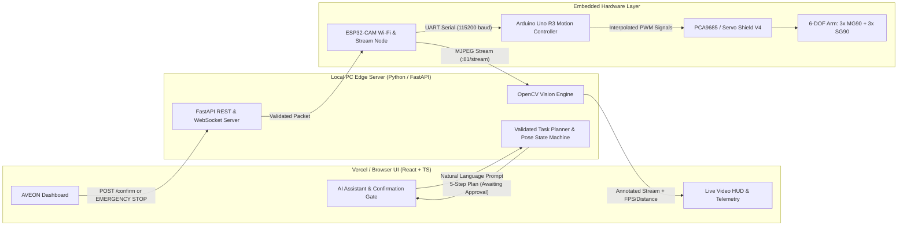

<div align="center">

# 🍁 AVEON
### **See. Understand. Act.**
**AI-Powered Computer Vision & Conversational Control Platform for 6-DOF Robotic Arms**

[](https://react.dev/)
[](https://tailwindcss.com/)
[](https://fastapi.tiangolo.com/)
[](https://opencv.org/)
[](https://www.arduino.cc/)
[](./LICENSE)

[Overview](#-overview) • [Architecture](#-system-architecture) • [Features](#-key-features) • [Hardware & Wiring](#-hardware--wiring) • [Installation Guide](#-installation-guide) • [Calibration](#-camera--servo-calibration) • [Deployment](#-https--remote-deployment) • [Troubleshooting](#-troubleshooting)

</div>

---

## 📌 Overview

**AVEON** is an end-to-end robotics control web application that bridges real-time OpenCV computer vision, natural language task planning, and deterministic microcontroller actuation. 

Designed for a **6-DOF robotic arm** powered by an **Arduino Uno R3**, **PCA9685 PWM driver**, and **ESP32-CAM**, AVEON allows operators to monitor live annotated camera feeds, track object distances and color coordinates, and issue natural language commands (e.g., *"Pick up the yellow cube and place it on the right side"*) through a safe, human-in-the-loop confirmation workflow.

### 📸 Interface Preview

| **Hardware Readiness & Login (`/login`)** | **Main Control Dashboard (`/dashboard`)** |
| :---: | :---: |
|  |  |

---

## 🏗 System Architecture

AVEON enforces strict isolation between AI intent parsing and physical hardware actuation. The AI Assistant never generates raw PWM signals; instead, it compiles natural language into a validated sequence of calibrated joint states that require operator confirmation before execution.



---

## ✨ Key Features

* **Real-Time Computer Vision Engine**: Proxies the ESP32-CAM MJPEG stream through FastAPI with a live HUD (`FPS`, `640×480`, latency in `ms`), Haar/DNN human face detection, HSV multi-color segmentation (**Red, Yellow, Green, Blue**), and calibrated distance estimation (`cm`).
* **Human-in-the-Loop AI Task Planner**: Translates natural language prompts into a numbered 5-step execution plan (*Locate → Move → Grip → Transport → Release*) with mandatory **Yes, proceed** and **Cancel** confirmation buttons inside the chat UI.
* **Hardware Safety & Protection**: Non-blocking servo interpolation on the Arduino Uno, strict per-joint angle limits, quick-action chips (`Pick and place`, `Move forward`, `Open gripper`, `Close gripper`), and a global **STOP** interrupt.
* **Built-in Demo & Simulation Mode**: Clicking **Try Demo Login** on `/login` boots a synthetic 640×480 virtual camera workspace and simulated robot telemetry when physical hardware is unplugged.

---

## 🔌 Hardware & Wiring

### Bill of Materials (BOM)
| Component | Qty | Role |
| :--- | :---: | :--- |
| **Arduino Uno R3** | 1 | Real-time servo interpolation & mechanical limit enforcement |
| **ESP32-CAM (AI-Thinker)** | 1 | Wireless MJPEG video streaming & Wi-Fi-to-UART command bridge |
| **PCA9685 16-Ch PWM Driver** *(or Sensor Shield V4)* | 1 | I2C PWM signal generation with isolated power rail |
| **MG90S Metal Gear Servos** | 3 | Base (`J1`), Shoulder (`J2`), and Elbow (`J3`) joints |
| **SG90 Micro Servos** | 3 | Wrist Pitch (`J4`), Wrist Roll (`J5`), and Gripper (`J6`) |
| **External 5V–6V 3A+ DC Power Supply** | 1 | Dedicated servo power rail (connect common `GND` to Arduino & ESP32) |

### Pinout & Joint Mapping (`PCA9685` ↔ `Arduino Uno`)

| Joint | Axis / Function | Servo Type | PCA9685 Channel | Safe Angle Limits | Home Angle |
| :---: | :--- | :---: | :---: | :---: | :---: |
| **J1** | Base Rotation | MG90S | `CH0` | `0° – 180°` | `90°` |
| **J2** | Shoulder Lift | MG90S | `CH1` | `15° – 165°` | `90°` |
| **J3** | Elbow Pitch | MG90S | `CH2` | `0° – 180°` | `90°` |
| **J4** | Wrist Pitch | SG90 | `CH3` | `0° – 180°` | `90°` |
| **J5** | Wrist Roll | SG90 | `CH4` | `0° – 180°` | `90°` |
| **J6** | Gripper Jaw | SG90 | `CH5` | `20° (Open) – 110° (Closed)` | `20°` |

* **I2C Wiring (Arduino Uno → PCA9685)**: `A4 (SDA) → SDA`, `A5 (SCL) → SCL`, `5V → VCC`, `GND → GND`.
* **UART Bridge (ESP32-CAM → Arduino Uno)**: `U0TXD (GPIO 1) → RX (Pin 0)`, `U0RXD (GPIO 3) → TX (Pin 1)` (via 5V-to-3.3V divider), `GND → GND`.

---

## 🛠️ Installation Guide

### 1. Prerequisites
* **Node.js** (`v18+`) & **npm**
* **Python** (`v3.10+`)
* **Arduino IDE** (`v2.0+`)
* **Git**

### 2. Clone the Repository
```bash
git clone https://github.com/lextleo/aveon.git
cd aveon
```

### 3. Backend Setup (FastAPI + OpenCV)
```bash
cd backend
python -m venv venv

# Activate virtual environment (Windows):
venv\Scripts\activate
# Activate virtual environment (Linux / macOS):
source venv/bin/activate

pip install --upgrade pip
pip install -r requirements.txt
cp .env.example .env
```

Update `backend/.env` with your configuration:
```ini
CONTROL_MODE=SIMULATION                      # Options: SIMULATION | ESP32_WIFI | USB_SERIAL
CAMERA_SOURCE=SIMULATED                      # Options: SIMULATED | WEBCAM | ESP32_STREAM
ESP32_CAM_STREAM_URL=http://192.168.1.150:81/stream
ESP32_CAM_CMD_URL=http://192.168.1.150/command
SERIAL_PORT=COM5                             # Linux/macOS: /dev/ttyUSB0 or /dev/ttyACM0
SERIAL_BAUDRATE=115200
KNOWN_OBJECT_WIDTH_CM=4.0
CALIBRATED_FOCAL_LENGTH=615.0
```

Start the FastAPI backend server:
```bash
uvicorn app.main:app --host 0.0.0.0 --port 8000 --reload
```

### 4. Frontend Setup (React + Vite + TypeScript)
Open a second terminal window:
```bash
cd frontend
npm install
cp .env.example .env
npm run dev
```
* Open `http://localhost:5173` in your browser.
* Click **Try Demo Login** on `/login` to test the vision HUD and chatbot in Simulation Mode right away.

### 5. Hardware Firmware Flashing
1. **Arduino Uno R3 (`firmware/arduino_arm_controller/arduino_arm_controller.ino`)**:
   * In Arduino IDE, open **Library Manager** and install **`Adafruit PWM Servo Driver Library`**.
   * Disconnect `RX/TX` jumper wires from pins `0` and `1`, select **Arduino Uno**, and click **Upload**.
   * Open Serial Monitor (`115200 baud`, `Newline`) and send `<HOME>` to verify the `ACK:POS:90,90,90,90,90,20:GRIP:OPEN` response.
2. **ESP32-CAM (`firmware/esp32_cam_node/esp32_cam_node.ino`)**:
   * Enter your 2.4 GHz Wi-Fi `ssid` and `password` in the sketch.
   * Select **Board: AI Thinker ESP32-CAM** and **Partition Scheme: Huge APP (3MB No OTA/1MB SPIFFS)**.
   * Ground `GPIO 0` (or hold `IO0` on the ESP32-CAM-MB shield) and click **Upload**.
   * Unplug `GPIO 0` from `GND`, press `RST`, copy the IP printed in the Serial Monitor (`115200 baud`), and update `ESP32_CAM_STREAM_URL` in `backend/.env`.

---

## 🎯 Camera & Servo Calibration

* **Distance Calibration**: Place a cube of known width (`W = 4.0 cm`) at a measured distance (`D = 30.0 cm`) from the lens. Read the bounding-box pixel width (`P`) and compute focal length `F = (P * D) / W`, then set `CALIBRATED_FOCAL_LENGTH` in `backend/.env`.
* **Serial Protocol (`115200 baud`)**:
  * `<HOME>\n` — Smoothly interpolate all 6 joints to home angles
  * `<CMD,J1,J2,J3,J4,J5,J6>\n` — Move joints to validated target angles
  * `<GRIP,OPEN>\n` / `<GRIP,CLOSE>\n` — Open (`20°`) or close (`105°`) gripper jaw
  * `<STOP>\n` — Immediate emergency halt

---

## 🔒 HTTPS & Remote Deployment

1. **Frontend (Vercel)**: Deploy `frontend/` to Vercel and set `VITE_API_BASE_URL` and `VITE_WS_URL` to your tunnel domain.
2. **Local HTTPS Reverse Proxy (`Caddy`)**:
   ```bash
   caddy run --config deploy/Caddyfile
   ```
3. **Remote Access (`Cloudflare Tunnel`)**:
   ```bash
   cloudflared tunnel --config deploy/cloudflared-config.yml run aveon-edge
   ```

---

## 🔧 Troubleshooting

| Issue | Cause | Solution |
| :--- | :--- | :--- |
| **`Brownout detector was triggered`** on ESP32-CAM | Insufficient USB / 3.3V current during Wi-Fi TX | Power ESP32-CAM via the `5V` pin from a stable 5V 2A+ supply and use a short data USB cable. |
| **Arduino resets when servos move** | Servo stall current overloading Arduino 5V regulator | Power servos exclusively through the PCA9685 `V+` terminal using an external 5V–6V 3A+ supply with shared `GND`. |
| **Camera stream blocked on Vercel** | Browser Mixed Content (`HTTPS` → local `HTTP`) | Route the local FastAPI server through the `Cloudflare Tunnel` or `Caddy` HTTPS proxy. |

---

## 📄 License

Distributed under the **MIT License**. See [`LICENSE`](./LICENSE) for more information.
